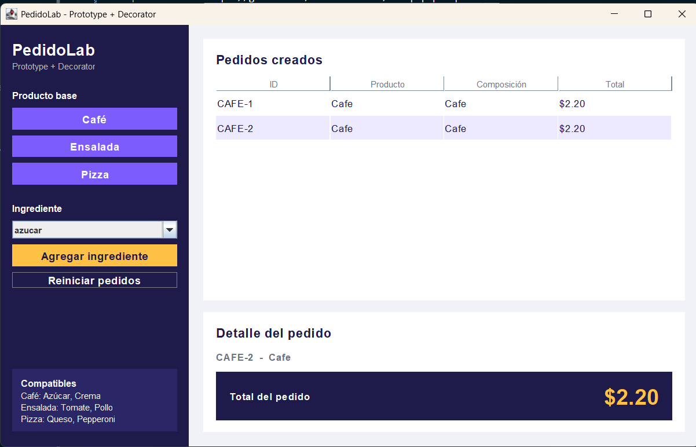
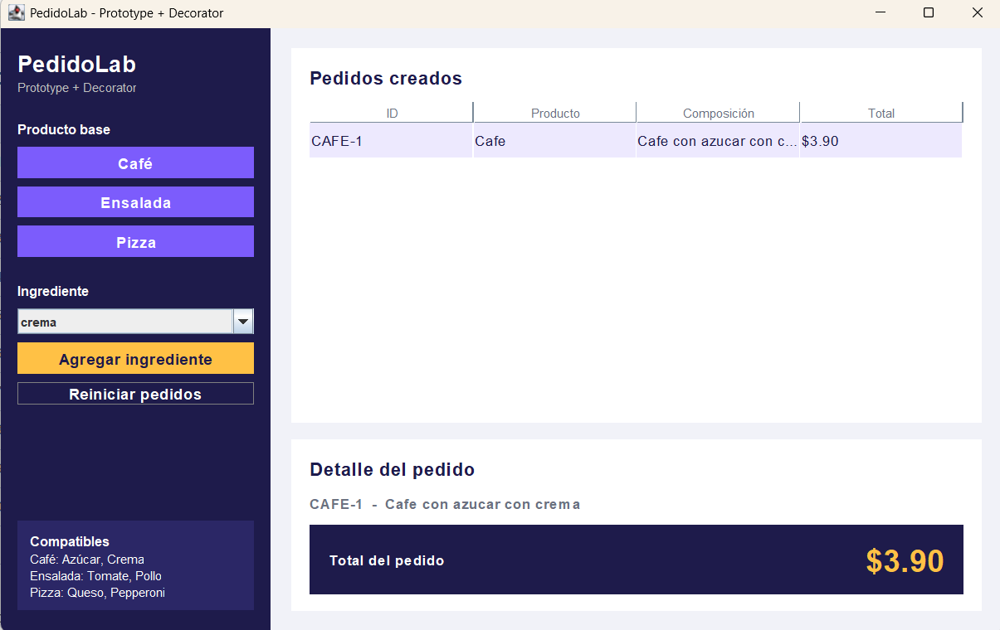
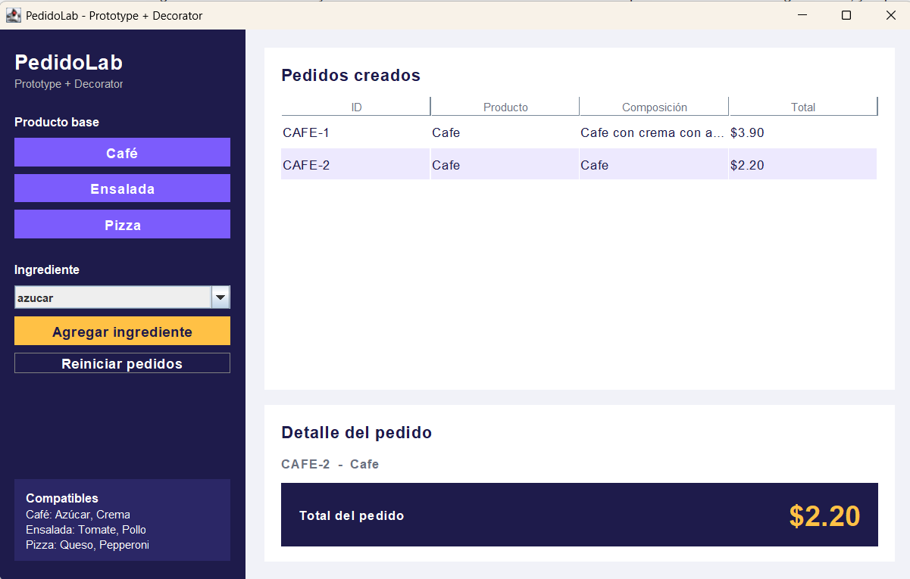
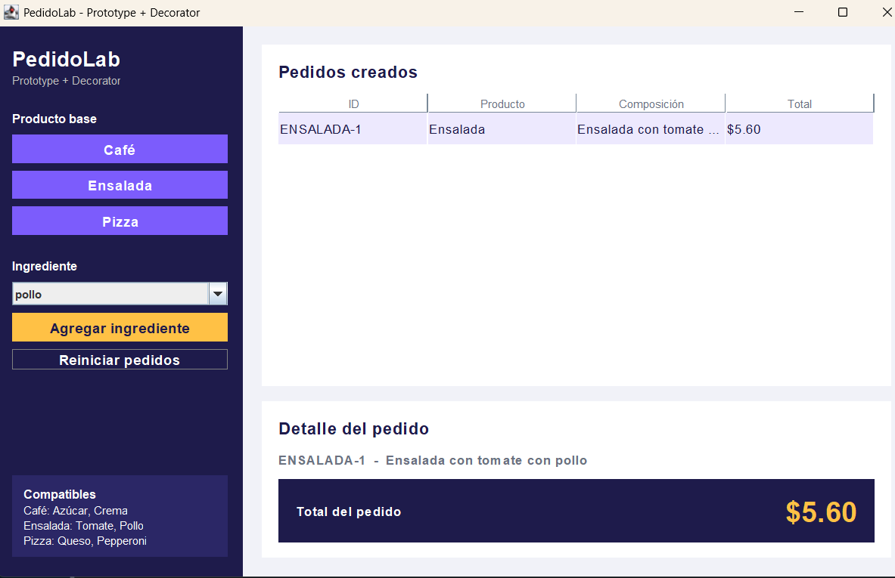
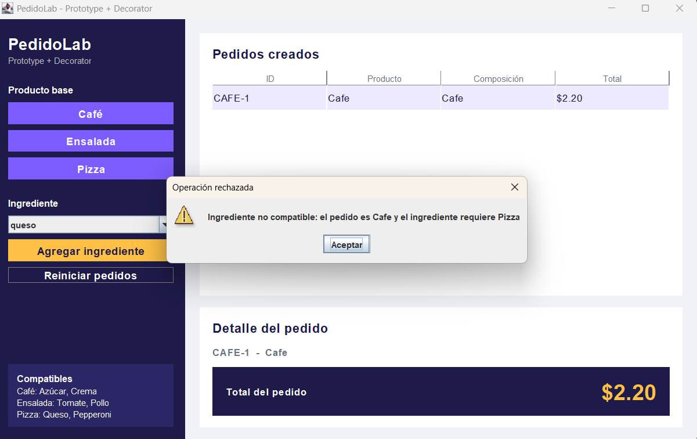
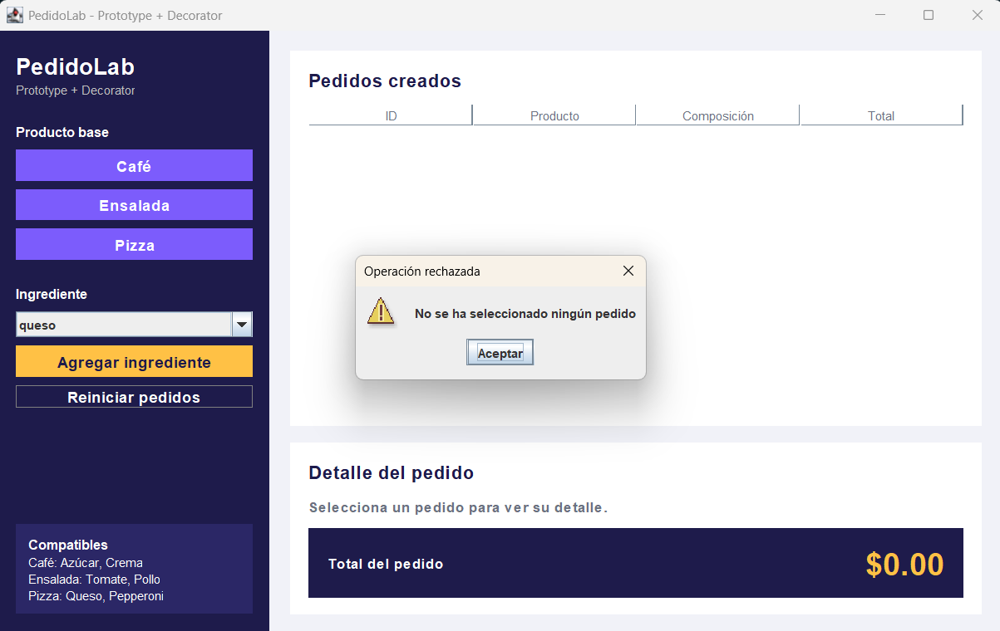
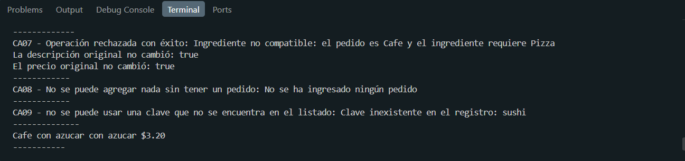
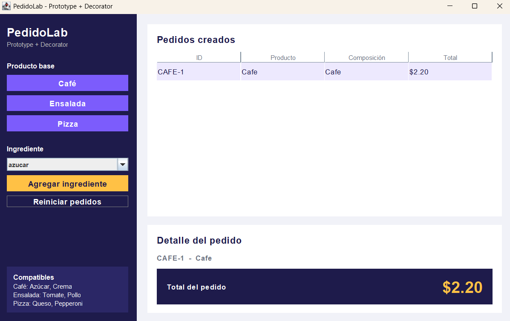

# Evidencias APP1 — PedidoLab

**Repositorio:** https://github.com/LuisRomero130/icc-pap-pl1-patrones 
**Integrantes:**  Luis Javier Romero
**Fecha:** 8 de noviembre de 2026

| Caso | Entrada | Resultado esperado | Resultado real | Evidencia | Estado |
|---|---|---|---|---|---|
| CA01 | Clonar Café dos veces | IDs diferentes; ambos empiezan en $2.20 | Generados `CAFE-1` y `CAFE-2` con precio base de $2.20 cada uno |  | Aprobado |
| CA02 | Comparar clon y objeto del registro | Referencias distintas; el prototipo conserva su configuración | `clon != prototipo` en memoria; modificar el clon no afecta la plantilla |  | Aprobado |
| CA03 | Al primer Café agregar Azúcar y Crema | Descripción incluye los dos ingredientes; total $3.90 | `CAFE-1` muestra "Cafe con azucar con crema" y total $3.90 | | Aprobado |
| CA04 | Consultar el segundo Café sin ingredientes | Mantiene $2.20, sin ingredientes | `CAFE-2` se conserva independiente con precio $2.20 |  | Aprobado |
| CA05 | Clonar Ensalada y agregar Tomate y Pollo | Total $5.60 | Ensalada decorada correctamente alcanzando el total de $5.60 |  | Aprobado |
| CA06 | Clonar Pizza y agregar Queso y Pepperoni | Total $7.10 | Pizza decorada correctamente alcanzando el total de $7.10 | | Aprobado |
| CA07 | Intentar agregar Queso a Café | Operación rechazada; total y descripción no cambian | Se lanza excepción de incompatibilidad y salta alerta sin modificar el pedido |  | Aprobado |
| CA08 | Agregar ingrediente sin pedido seleccionado | Mensaje claro y ningún cambio de estado | Muestra advertencia "Seleccione un pedido" sin alterar la lista | | Aprobado |
| CA09 | Solicitar clon de clave inexistente | Fallo controlado; no se crea pedido | El registro maneja la clave no registrada sin romper la aplicación |  | Aprobado |
| CA10 | Agregar dos veces Azúcar a un Café | Total $3.20 y dos aplicaciones del decorador | Se envuelve dos veces en `Azucar`, incrementando costo a $3.20 |  | Aprobado |
| CA11 | Reiniciar y volver a clonar Café | Nuevos pedidos parten nuevamente del valor base $2.20 | Se limpia la lista y el contador; nuevos cafés inician en $2.20 |  | Aprobado |

## Identificación de patrones

- **Prototype:**
  - *Clase:* `RegistroPrototipos.java`
  - *Método:* `clonar(String clave)` / `clonar()` en interfaz `Pedido.java`
  - *Archivo:* `modelo/RegistroPrototipos.java` y `modelo/Cafe.java` (entre otros productos base).

- **Decorator:**
  - *Clase abstracta:* `DecoradorIngrediente.java`
  - *Referencia al componente:* Atributo protegido `protected Pedido pedido` dentro de `DecoradorIngrediente`.
  - *Decoradores concretos:* `Azucar.java` y `Crema.java` (así como `Tomate`, `Pollo`, `Queso`, `Pepperoni`).

- **Integración:**
  - *Método:* `agregarIngrediente(String idPedido, String ingrediente)` en `servicio/ServicioPedidos.java`, donde se obtiene el clon por ID y se le aplican encadenadamente múltiples decoradores antes de actualizar la lista.

## Decisiones de diseño

1. **Encapsulamiento de compatibilidad en el Servicio:** Las reglas que determinan qué ingrediente puede ir en cada producto están en `ServicioPedidos`, evitando que la vista (Swing) contenga lógica de negocio.
2. **Reemplazo in-place manteniendo la identidad:** Cuando se aplica un ingrediente, la versión decorada envuelve al objeto previo reteniendo el mismo identificador (`ID`), lo que permite el encadenamiento ilimitado de decoradores.

## Conclusiones

1. El patrón **Prototype** independiza la creación de productos base de su instanciación directa, garantizando que cada nuevo pedido sea una copia limpia y desacoplada del molde inicial.
2. El patrón **Decorator** resuelve la combinación dinámica de ingredientes mediante composición sobre herencia, evitando una jerarquía excesiva de clases para cada combinación posible de menú.
3. La interfaz gráfica en Swing se integra limpiamente con la capa de servicio y modelo, permitiendo validar de forma transparente tanto la lógica de negocio como los casos de uso pedidos en la práctica.